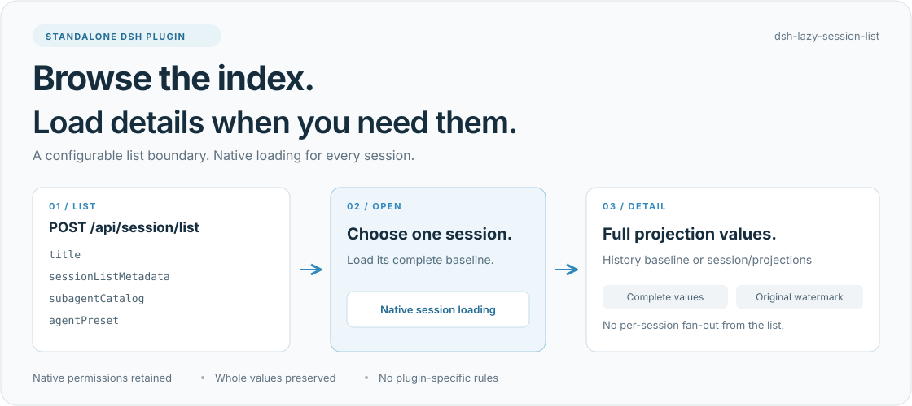
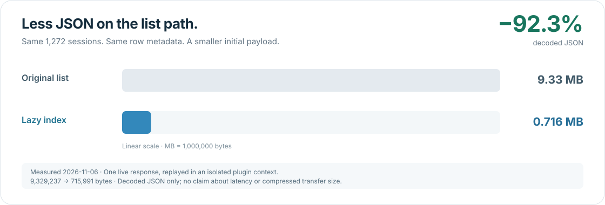

# dsh-lazy-session-list

**让会话列表保持轻量，完整详情在打开会话时加载。**

[](package.json) [](#兼容范围) [](LICENSE)

DSH 会话列表可能为每个会话附带大量 projection 数据。`dsh-lazy-session-list` 在列表返回时保留一个可配置的原生索引，其余内容由宿主的单会话接口按需提供。会话越多，初始列表里重复携带的详情就越值得省下来。

这是一个**独立发布、独立安装**的宿主插件，不属于 Apollo 整合包。它面向任意 DSH 插件组合，不识别第三方插件名称、私有字段或专用接口。



[安装](#安装) · [默认索引](#默认索引) · [配置](#配置) · [按需加载](#按需加载) · [测量结果](#测量结果) · [开发与验证](#开发与验证)

## 安装

在已安装受支持 DSH 的环境中，从本仓库独立安装。将 `web` 换成你的目标 profile：

```sh
dsh plugin --profile web add github:omdsh-dev/dsh-lazy-session-list
```

安装后重新加载或重启目标 profile，再刷新浏览器。使用一个新页面检查初始列表：旧页面已经加载的详情不会因为列表省略字段而自动清空。

也可以先从源码打包，再安装本地文件：

```sh
git clone https://github.com/omdsh-dev/dsh-lazy-session-list.git
cd dsh-lazy-session-list
npm pack
dsh plugin --profile web add ./dsh-lazy-session-list-0.2.0.tgz
```

移除这个独立 bundle，或禁用 `dsh-lazy-session-list` 行并重新加载 profile，即可恢复原列表行为。

## 默认索引

默认只保留四个 DSH 原生 projection key。未知字段和未来新增字段遵循相同规则，整 key 延迟加载。

| Key | 用途 |
| --- | --- |
| `title` | 在未打开会话时显示标题。 |
| `sessionListMetadata` | 空白状态、最近提示时间等列表信息。 |
| `subagentCatalog` | 子代理发现、父子导航和侧栏子代理计数。 |
| `agentPreset` | 已保存会话的预设索引。 |

会话行本身的 ID、工作目录、父会话、运行状态及其他 metadata 原样保留。原方法返回多少个可见会话，插件就返回多少行，顺序相同。**这是一项详情加载策略，不是会话行分页。**

## 配置

通过插件行的 `listProjectionKeys` 指定列表需要保留的字段。它是**完整白名单**：显式配置会替换默认值。要追加一个部署自定义索引，也需要把所需的原生键一起列出。

```yaml
- id: dsh-lazy-session-list
  name: dsh-lazy-session-list
  config:
    listProjectionKeys:
      - title
      - sessionListMetadata
      - subagentCatalog
      - agentPreset
      - deploymentIndex
```

`deploymentIndex` 是任意字段名的示例，不对应某个具体插件。源响应里不存在的键不会被合成；重复键不改变结果。空数组 `[]` 会省略全部 projection key，但也会失去原生列表依赖的索引。

## 按需加载

1. **浏览列表**：`POST /api/session/list` 只返回配置选中的 projection 索引。插件不会为列表中的每个会话再发起详情请求。
2. **打开会话**：宿主原生 history baseline 为该会话提供完整 projection。
3. **独立页面读取详情**：客户端插件可通过现有 sessions 服务显式加载指定会话。

```js
await ctx.sessions.refreshProjections(sessionId)
```

底层使用原生 `session/projections`。普通 projection 订阅本身只订阅缓存，不自动发起补载。依赖跨会话统计的页面，应自行提供按需加载或聚合接口，也可由部署在白名单中显式保留所需索引；本插件不会猜测其他插件的需求。

保留字段的 **whole value、`kind`、`asOfSeq`** 都保持原样；被延迟的字段整体省略。这样完整 baseline 即使与列表具有相同序号，也能补齐缺失字段。后续列表刷新不会清除客户端已加载的详情。

## 测量结果



2026-11-06，从本机运行实例读取了一份包含 **1,272 个会话**的列表响应，然后在隔离的 Cordis 上下文中应用默认策略。解压 JSON 从 **9,329,237 字节**缩减为 **715,991 字节**，减少 **92.3%**。

这是一份样本的响应体积对比，不是通用性能保证。测量没有启用运行实例中的插件，也没有请求任何单会话详情；它不代表压缩后的网络字节数、延迟改善或浏览器端到端结果。

可在自己的实例上复测：

```sh
npm run smoke -- http://127.0.0.1:3384
```

该脚本只读请求一次列表，在本地重放策略；输出行数、字节数和省略字段次数，不输出会话内容或 ID。

## 兼容范围

| 组件 | 当前验证版本 |
| --- | --- |
| DSH | `0.2.1-rc.2` |
| Cordis | `4.0.5` |
| Schemastery | `3.18.5` |
| Node.js | `^22.19.0` 或 `>=24.0.0` |

运行时由宿主提供 peer dependencies。纯 ESM，无构建步骤；其他 DSH 版本尚未验证。

插件在**原生授权过滤完成之后、JSON 编码之前**处理列表结果，保留调用方 context、参数、取消信号与错误传播。它只包装当前 `sessionController` 实例的 `list`；完整 history、control baseline 与单会话 projections 继续使用宿主原逻辑。

宿主仍会先构造原列表快照，因此收益主要在 JSON 编码、传输与客户端处理量；插件不承诺避免全部 projection 计算。卸载时先停用自身 wrapper，再按方法所有权恢复，支持与遵守相同规则的独立 wrapper 叠加。

## 开发与验证

```sh
npm install
npm ci --prefix tests/client-support
npm test
```

当前回归套件 **21 项通过，0 跳过**。测试使用真实 Cordis、宿主原始 `SessionController.list` 和真实客户端 `SessionManager`，控制查询源数据与授权策略，覆盖：

- 通用白名单、未知字段整体延迟与原始数据不变。
- 冷客户端不扇出；只补载指定会话；同序号完整值补齐。
- 原生列表索引、并发调用方权限、取消与错误传播。
- 实例隔离、方法描述符恢复、两种挂载顺序与两种卸载顺序、在途卸载。
- smoke 的单请求预算与输出范围。

用相同断言对未修改的宿主运行，可以复现默认全量详情问题；下面命令预期有两项策略断言失败：

```sh
LAZY_SESSION_LIST_BASELINE=1 node --test \
  --test-name-pattern="list keeps only|a cold client" \
  tests/session-list.test.mjs
```

测试支持目录单独安装匹配版本的浏览器 store、Zustand 和 Immer，不进入插件发布包。

## 许可证

[Apache-2.0](LICENSE) · [报告问题](https://github.com/omdsh-dev/dsh-lazy-session-list/issues)
